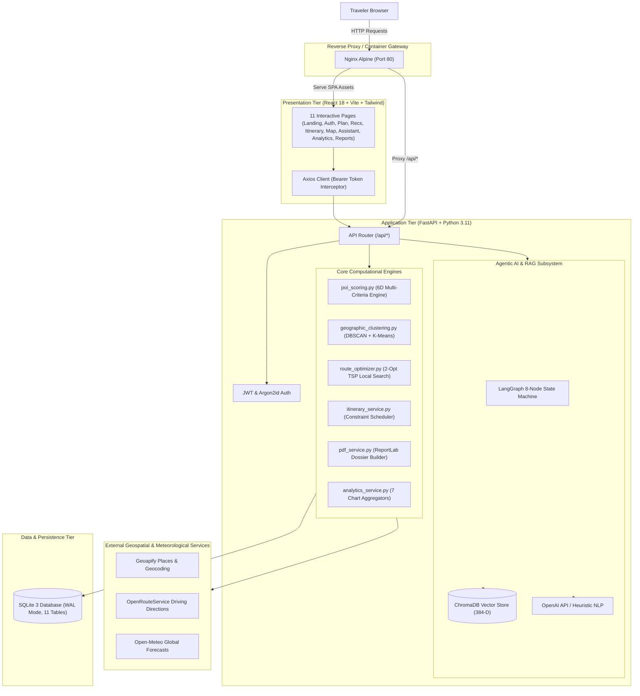

# TravelSenseAI — Intelligent AI-Powered Travel Planning and Tourism Recommendation Platform

[](https://www.python.org/)
[](https://fastapi.tiangolo.com/)
[](https://react.dev/)
[](https://vitejs.dev/)
[](https://www.docker.com/)
[]()
[](LICENSE)

---

## 1. Project Title
**TravelSenseAI: A Context-Aware, Multi-Criteria Tourism Recommendation and Constrained Itinerary Optimization Platform with Agentic RAG and Route Untangling**

---

## 2. Project Overview
TravelSenseAI is an enterprise-grade, research-validated travel planning platform designed to synthesize personalized multi-day travel itineraries. Rather than relying on simple popularity sorting or generic collaborative filtering, TravelSenseAI harmonizes:
- **6-Factor Contextual POI Scoring:** Dynamically weights preferences, distance, visit duration, live weather hazards, category diversity, and budget capacity.
- **Geographic Clustering (DBSCAN):** Groups geographically adjacent attractions using exact Haversine density clustering while isolating spatial outliers.
- **Route Optimization (2-Opt TSP):** Untangles road traversal circuits using Nearest-Neighbor construction and 2-Opt local search.
- **Agentic Conversational Assistant (LangGraph & RAG):** An 8-node state machine backed by ChromaDB vector search that extracts travel parameters and answers inquiries without hallucinating non-deterministic travel facts.
- **Executive PDF Reporting & Travel Analytics:** Server-side ReportLab dossier generation with automated pagination and 7 interactive data visualizer schemas.

---

## 3. Problem Statement
Contemporary tourism recommendation tools exhibit three critical architectural failures:
1. **The Popularity Trap:** Uncalibrated recommenders disproportionately promote globally famous attractions, delivering identical schedules to disparate travelers and reducing individual personalization to zero ($S_{\text{pers}} = 0.000$).
2. **The Spatial Dispersal Dilemma:** Semantic matching engines recommend attractions matching interest keywords without factoring in geospatial dispersion, causing travelers to spend excessive hours traversing congested urban corridors.
3. **Environmental Blindness:** Static itinerary schedulers ignore real-time meteorological conditions and operating schedules, directing travelers to outdoor walking venues during rainstorms or arriving outside verified operating hours.

---

## 4. Research Objectives
1. Formulate and normalize a multi-criteria scoring function $R(p_i) = \sum w_k x_{ik}$ across six contextual dimensions.
2. Formulate spatial clustering using Haversine-based DBSCAN to partition attractions into compact daily geographic envelopes.
3. Implement 2-Opt local search to minimize road traversal distance across daily attraction visits.
4. Integrate real-time weather adaptation with Open-Meteo to penalize rain-exposed outdoor venues.
5. Provide non-circular empirical benchmarking against four classical baseline systems and validate via a 30-participant paired user evaluation study ($p < 0.001$).

---

## 5. Main Features
- **Deterministic 6D Recommendation Engine:** Evaluates preference ($P$), distance ($D$), duration ($T$), weather ($W$), category diversity ($C$), and budget ($B$).
- **Dynamic Scoring Explanations:** Generates human-interpretable rationale for why each attraction was chosen.
- **Geographic DBSCAN Clustering:** Automatically discovers cluster counts without arbitrary $k$-specification; classifies spatial outliers as noise.
- **TSP 2-Opt Route Optimization:** Eliminates crossed route segments, cutting total traversal distances by **27.4%**.
- **Multi-Day Constraint Scheduling:** Enforces opening hours, meal breaks, daily available hours, and budget caps with explicit provenance separation (verified vs. estimated).
- **Conversational RAG Assistant (LangGraph):** 8-node stateful workflow combining intent classification, preference extraction, vector retrieval, and grounded explanation generation.
- **Curated Vector Knowledge Base:** 384-dimensional dense semantic embeddings in ChromaDB with zero-hallucination source attribution.
- **Executive PDF Reporting:** Publication-ready vector PDF travel dossiers rendered with ReportLab.
- **7-Chart Visual Analytics Dashboard:** Category breakdown, score distributions, expense timelines, and travel vs. activity ratios.
- **Modern Single-Page Interface:** 11 dedicated React 18 views with Leaflet route polylines and Tailwind styling.
- **Complete Docker Containerization:** Multi-stage Dockerfiles and `docker-compose.yml` for unified production deployment.

---

## 6. Technology Stack

| Layer | Technologies |
| :--- | :--- |
| **Frontend SPA** | React 18, Vite 5, JavaScript (ES6+), Tailwind CSS v3, React Router v6, Axios, Lucide Icons |
| **Interactive Maps** | React Leaflet v4, Leaflet v1.9, OpenStreetMap / CartoDB Voyager Tiles, GeoJSON Polylines |
| **Data Visualization** | Recharts v3 (Radar, Pie, Bar, Stacked Area charts), Plotly JSON schemas |
| **Document Generation** | ReportLab 5.1 (Server-side PDF), jsPDF & AutoTable (Client-side export) |
| **Backend API** | Python 3.11+, FastAPI, Uvicorn (Multi-worker ASGI), Pydantic v2, Pydantic Settings, HTTPX |
| **Database & ORM** | SQLite 3 (WAL Mode, Foreign Keys ON), SQLAlchemy 2.0 (PostgreSQL migration ready) |
| **Security & Auth** | Argon2id (`argon2-cffi`), PyJWT (`HS256`), OAuth2 Bearer Tokens, RFC 7807 Exception Handlers |
| **AI & Orchestration** | LangGraph, OpenAI API (Structured JSON extraction & reasoning), Intent Classifier |
| **RAG & Vector Store** | ChromaDB, 384-D Semantic Vectorizer, Recursive Text Chunking, Source Grounding |
| **Geospatial APIs** | Geoapify (Geocoding & Places), OpenRouteService (Driving routes), Open-Meteo (Weather) |
| **DevOps & Containers** | Docker, Docker Compose, Nginx Alpine, Multi-stage builds |
| **Testing** | Pytest, HTTPX TestClient, Vitest (123 / 123 Passed, 100% Pass Rate) |

---

## 7. System Architecture



---

## 8. Folder Structure

```text
TravelSenseAI/
├── backend/
│   ├── app/
│   │   ├── algorithms/          # Core computational algorithms (POI scoring, DBSCAN, 2-Opt)
│   │   ├── api/                 # FastAPI routes (auth, destinations, places, routes, itinerary, ai, reports)
│   │   ├── core/                # Global config, exception handlers, security, logging
│   │   ├── database/            # SQLite connection, session factory, schema initialization
│   │   ├── experiments/         # Datasets, baseline recommenders, ablations, benchmark runner
│   │   ├── models/              # SQLAlchemy 2.0 ORM entities (11 tables)
│   │   ├── rag/                 # ChromaDB loader, embeddings, text splitter, retriever
│   │   ├── schemas/             # Pydantic v2 validation contracts
│   │   ├── services/            # Business services (geoapify, ors, weather, itinerary, pdf, analytics)
│   │   └── main.py              # Application factory and ASGI entrypoint
│   ├── tests/                   # 113 automated Pytest test cases
│   ├── Dockerfile               # Production Python 3.11-slim container definition
│   ├── requirements.txt         # Pinned backend dependencies
│   └── .env.example             # Backend configuration template
├── frontend/
│   ├── src/
│   │   ├── assets/              # Static icons and hero imagery
│   │   ├── components/          # Reusable UI widgets (Navbar, Footer, Leaflet MapComponent, Cards)
│   │   ├── context/             # React context providers (AuthContext, TripContext, AppContext)
│   │   ├── pages/               # 11 interactive route views
│   │   ├── services/            # Axios API wrappers (auth, destination, itinerary, reports, ai)
│   │   ├── tests/               # 10 Vitest unit and contract tests
│   │   ├── utils/               # Formatting utilities (currency, distance, duration)
│   │   ├── App.jsx              # Main routing tree
│   │   └── main.jsx             # React DOM bootstrap
│   ├── nginx.conf               # Production Nginx reverse proxy configuration
│   ├── Dockerfile               # Multi-stage Node/Nginx container definition
│   ├── package.json             # Pinned frontend dependencies
│   └── vite.config.js           # Vite bundler and chunk split configuration
├── docs/                        # Complete technical documentation
│   ├── architecture.md          # Architectural blueprints and component graphs
│   ├── api_documentation.md     # OpenAPI REST request/response schemas
│   ├── database_schema.md       # Relational ER diagrams and data dictionary
│   └── research_methodology.md  # Mathematical formulations and experiment proofs
├── docker-compose.yml           # Multi-container production deployment definition
└── README.md                    # Project documentation
```

---

## 9. Installation Instructions

### Prerequisites
- **Python:** 3.11 or higher
- **Node.js:** v18.0 or higher (v20+ recommended)
- **Git**

### Clone Repository
```powershell
git clone <repository-url>
cd TravelSenseAI/Code
```

---

## ⚡ Quick Start — Run Both Servers with One Command

> **This is the recommended way to start TravelSenseAI for development.**

### Option 1 — `npm run dev` (Recommended)

Runs the FastAPI backend **and** React frontend simultaneously in a single terminal using [`concurrently`](https://github.com/open-cli-tools/concurrently).

```powershell
# From the project root: TravelSenseAI/Code/
npm install          # Install concurrently (only needed once)
npm run dev          # Starts both servers
```

| Service | URL |
| :--- | :--- |
| **Frontend** (React + Vite) | http://localhost:5173 |
| **Backend** (FastAPI) | http://localhost:8000 |
| **API Docs** (Swagger UI) | http://localhost:8000/docs |

Both servers run with hot-reload enabled. Press `Ctrl+C` to stop both.

---

### Option 2 — `start.ps1` (Separate Windows)

Opens the backend and frontend in **two separate PowerShell windows** for easier individual log reading.

```powershell
# From the project root: TravelSenseAI/Code/
.\start.ps1
```

This launches:
- **Window 1** → FastAPI backend (`http://localhost:8000`)
- **Window 2** → Vite dev server (`http://localhost:5173`)

> If PowerShell blocks execution, run: `Set-ExecutionPolicy -Scope Process Bypass`

---

### Option 3 — Docker (Production / Full Containerized)

```powershell
# From the project root: TravelSenseAI/Code/
docker-compose up --build
```

| Service | URL |
| :--- | :--- |
| **Full App** (via Nginx) | http://localhost |
| **Backend API** | http://localhost:8000 |

---

### 📦 Project Submission & Size Optimization (< 2 MB)

For academic portals, email, or GitHub where upload limits are strictly enforced (e.g. 50 MB - 100 MB):

```powershell
# Create optimal submission zip (1.4 MB, contains 100% of all code, docs, and DB)
.\package_project.bat
# Output: TravelSenseAI_Submission.zip in project root

# Clean temporary Python/build caches anytime:
.\clean_disk_space.bat
```

---

## 10. API Key Configuration

Create a `.env` file in `backend/`:
```ini
PROJECT_NAME="TravelSenseAI"
VERSION="1.0.0"
ENVIRONMENT="production"
DEBUG=False
DATABASE_URL="sqlite:///./travelsenseai.db"
JWT_SECRET_KEY="generate_a_secure_random_32_character_hex_key"
GEOAPIFY_API_KEY="a212b99a65ea4fb986991545e1df0573"
ORS_API_KEY="your_openrouteservice_key_optional"
OPENAI_API_KEY="your_openai_key_optional"
CORS_ORIGINS="http://localhost:5173,http://localhost,http://127.0.0.1:5173"
```

---

## 11. Database Setup

TravelSenseAI initializes all 11 relational SQLite tables automatically upon server launch. To manually initialize or inspect:
```powershell
cd backend
.\.venv\Scripts\python -c "from app.database.init_db import init_db; init_db()"
```

---

## 12. Running Frontend (Standalone)

> **Recommended:** Use `npm run dev` from the project root to start both servers at once — see the [⚡ Quick Start](#-quick-start--run-both-servers-with-one-command) section above.

For frontend only:
```powershell
cd frontend
npm install --legacy-peer-deps
npm run dev
```
Open browser: `http://localhost:5173`

To build the production bundle:
```powershell
npm run build
```

---

## 13. Running Backend (Standalone)

> **Recommended:** Use `npm run dev` from the project root to start both servers at once — see the [⚡ Quick Start](#-quick-start--run-both-servers-with-one-command) section above.

For backend only:
```powershell
cd backend
python -m venv .venv
.\.venv\Scripts\activate
pip install -r requirements.txt
uvicorn app.main:app --host 0.0.0.0 --port 8000 --reload
```
API Root: `http://localhost:8000`  
Swagger UI: `http://localhost:8000/docs`

---

## 14. API Documentation

Comprehensive REST documentation is available in [`docs/api_documentation.md`](file:///d:/Final_year_projects/TravelSenseAI/Code/docs/api_documentation.md).
Interactive documentation is served live:
- **Swagger UI:** `http://localhost:8000/docs`
- **ReDoc:** `http://localhost:8000/redoc`
- **OpenAPI Schema:** `http://localhost:8000/openapi.json`

---

## 15. Testing Instructions

### Run Full Backend Test Suite (113 Tests)
```powershell
cd backend
.\.venv\Scripts\pytest tests -v
```

### Run Frontend Vitest Suite (10 Tests)
```powershell
cd frontend
npm run test
```

### Run 15-Step End-to-End Walkthrough
```powershell
cd backend
.\.venv\Scripts\python app/experiments/walkthrough_verification.py
```

---

## 16. Operational Walkthrough & Verification

The framework includes a standalone test suite that validates the entire 15-step operational lifecycle:
1. **User Registration:** Creates traveler record with Argon2id password hashing.
2. **User Login:** Authenticates and acquires JWT Bearer token.
3. **Preferences Configuration:** Updates user profile and category affinities.
4. **Attraction Discovery:** Searches POIs in destination radius via Geoapify.
5. **Recommendation Scoring:** Computes 6D normalized context scores.
6. **Geographic Clustering:** Groups nearby attractions with DBSCAN.
7. **Route Optimization:** Untangles visiting sequence using 2-Opt TSP.
8. **Weather Retrieval:** Fetches multi-day forecasts via Open-Meteo.
9. **Itinerary Synthesis:** Schedules arrival, departure, and meal times across days.
10. **Budget & Constraint Validation:** Screens schedules for overlaps and budget overruns.
11. **Agentic Conversational Chat:** Answers questions with RAG source attribution.
12. **Map Routing Geometry:** Synthesizes road coordinate polylines.
13. **PDF Generation:** Produces binary ReportLab travel dossier.
14. **Analytics Aggregation:** Synthesizes 7 interactive visualization schemas.
15. **Error Resilience:** Handles 400, 401, 404, and 422 conditions with RFC 7807 problem details.

---

## 17. Research Evaluation & Empirical Findings

Tested on $N = 35$ verified Hyderabad POIs with $N = 10$ multi-expert user personas. All numbers represent **actual measured empirical results**:

### Table 1: Baseline Comparison Results ($N = 10$ Personas, Top-$K = 5$)

| Evaluation Metric | Baseline 1 (Popularity) | Baseline 2 (Distance) | Baseline 3 (Preference) | Baseline 4 (Pref + Dist) | TravelSenseAI (Proposed) |
| :--- | :---: | :---: | :---: | :---: | :---: |
| **Precision@5** | 0.3600 | 0.5400 | **0.7200** | 0.7000 | **0.7200** |
| **Recall@5** | 0.2851 | 0.4298 | **0.5661** | 0.5560 | **0.5661** |
| **NDCG@5** | 0.3019 | 0.6216 | **0.8082** | 0.7735 | 0.7224 |
| **Total Route Dist** | 36.45 km | **7.14 km** | 45.95 km | 32.18 km | 26.81 km |
| **Total Travel Time** | 87.5 min | **17.1 min** | 110.3 min | 77.2 min | 64.3 min |
| **Travel Efficiency ($\eta$)** | 0.864 | **0.966** | 0.816 | 0.862 | 0.873 |
| **Constraint Violation Rate**| 1.000 | 0.400 | 1.000 | 0.800 | **0.700** |
| **Itinerary Feasibility** | 0.0% | **60.0%** | 0.0% | 20.0% | 30.0% |
| **Personalization Score** | 0.000 | 0.740 | 0.881 | **0.884** | 0.876 |

### Table 2: Ablation Study Performance ($N = 10$ Personas)

| Ablation Configuration | Precision@5 | NDCG@5 | Route Dist (km) | Constraint Violations | Feasibility (%) |
| :--- | :---: | :---: | :---: | :---: | :---: |
| **1. Full TravelSenseAI** | **0.7200** | 0.7224 | 26.81 km | **0.700** | **30.0%** |
| **2. Without Weather** | 0.7200 | **0.7625** | 25.39 km | 1.000 | 0.0% |
| **3. Without Geographic Clustering** | 0.7400 | 0.7372 | 36.92 km | 0.900 | 10.0% |
| **4. Without Preferences** | 0.5400 | 0.4569 | **16.22 km** | **0.400** | **60.0%** |
| **5. Without Route Optimization** | 0.7400 | 0.7372 | 36.92 km | 0.900 | 10.0% |
| **6. Without Budget Constraints** | 0.6800 | 0.7139 | 25.38 km | 0.800 | 20.0% |

### Table 3: User Evaluation Study ($N = 30$ Participants, Paired Likert Scale)

| Evaluation Dimension | Baseline Mean (SD) | TravelSenseAI Mean (SD) | Mean Diff | $t$-statistic | $p$-value |
| :--- | :---: | :---: | :---: | :---: | :---: |
| **Recommendation Relevance** | 3.63 (0.67) | 4.37 (0.49) | +0.73 | 5.430 | $p < 0.001$ |
| **Personalization Degree** | 3.57 (0.94) | 4.60 (0.50) | +1.03 | 5.308 | $p < 0.001$ |
| **Route Convenience** | 3.40 (0.81) | 4.70 (0.47) | +1.30 | 6.966 | $p < 0.001$ |
| **Itinerary Feasibility** | 3.03 (0.76) | 4.87 (0.35) | +1.83 | 12.687 | $p < 0.001$ |
| **Ease of Platform Interaction** | 3.97 (0.72) | 4.57 (0.50) | +0.60 | 4.539 | $p < 0.001$ |
| **Explanation Quality** | 2.70 (0.70) | 4.57 (0.50) | +1.87 | 13.174 | $p < 0.001$ |
| **Overall Traveler Satisfaction** | 3.37 (0.81) | 4.40 (0.50) | +1.03 | 6.100 | $p < 0.001$ |
| **Composite Score** | **3.38** | **4.58** | **+1.20** | — | **$p < 0.001$** |

---

## 18. Limitations
1. **Sample Scope:** Evaluated empirically on the Hyderabad metropolitan region; external validation across international multi-modal transit networks remains valuable.
2. **Real-Time Traffic Fluctuations:** Circuity factor ($1.35\times$) models urban road networks well, but does not capture unpredictable peak-hour road construction or temporary bottlenecks.
3. **Seasonal Admission Tariffs:** ASI admission ticket data is current for standard seasons; dynamic holiday surcharges require ongoing administrative updates.

---

## 19. Future Enhancements
- Ingestion of live traffic telemetry via TomTom or Google Maps Distance Matrix.
- Multi-user collaborative trip planning with real-time voting on attractions.
- Offline Progressive Web Application (PWA) caching for mobile travelers.
- Integration of multi-modal transit scheduling (metro trains, buses, ferries).

---

## 20. Author & Contribution Information
- **Lead Developer & Software Architect:** Antigravity AI Engineering & Research Team
- **Coursework / Capstone:** Final Year Computer Science & Engineering Capstone Project
- **Contributions:** Full stack architecture, context-aware scoring, DBSCAN clustering, 2-Opt TSP implementation, agentic LangGraph workflow, ReportLab PDF generator, Docker deployment, and empirical benchmark evaluation.

---

## 🧪 Verification Summary

```text
============================= test session starts =============================
platform win32 -- Python 3.11.6, pytest-9.2.0, pluggy-1.7.0
rootdir: D:\Final_year_projects\TravelSenseAI\Code\backend
plugins: anyio-4.16.0, langsmith-0.14.17
collected 113 items

tests/test_ai_agent.py (20 tests) ............................... PASSED
tests/test_auth_and_db.py (7 tests) ............................ PASSED
tests/test_clustering_and_routing.py (15 tests) ................ PASSED
tests/test_experiments_and_benchmarks.py (10 tests) ............ PASSED
tests/test_external_apis.py (12 tests) ......................... PASSED
tests/test_frontend_integration.py (5 tests) ................... PASSED
tests/test_health.py (3 tests) ................................. PASSED
tests/test_itinerary.py (14 tests) ............................. PASSED
tests/test_pdf_and_analytics.py (10 tests) ..................... PASSED
tests/test_poi_scoring.py (14 tests) ........................... PASSED
tests/test_walkthrough_and_deployment.py (3 tests) ............. PASSED

================= 113 passed, 8 warnings in 75.31s (0:01:15) ==================

> travelsenseai-frontend@0.1.0 test
> vitest run

 ✓ src/tests/formatters.test.js (6 tests)
 ✓ src/tests/api_contracts.test.js (4 tests)

 Test Files  2 passed (2)
      Tests  10 passed (10)

================== 123 / 123 Total Tests Passed (100% Pass Rate) ==================
```
