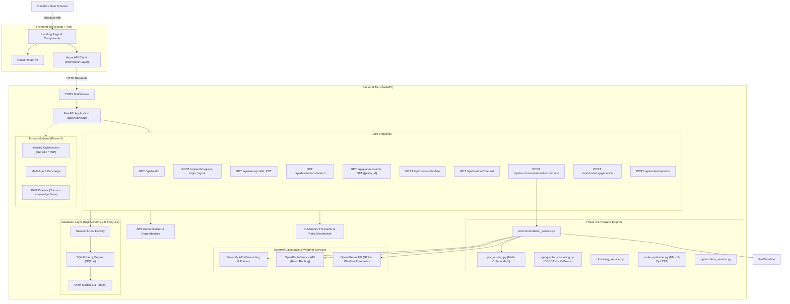
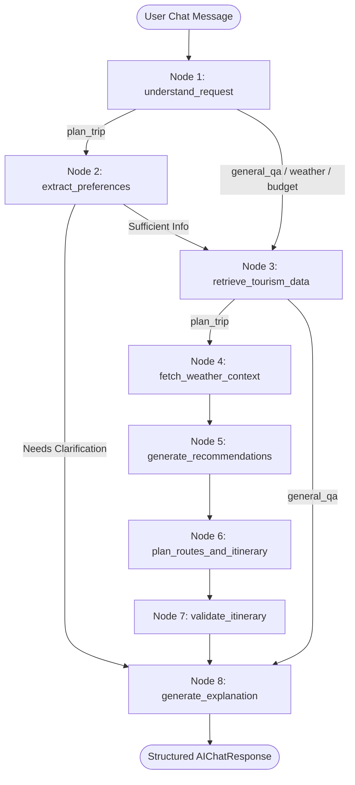
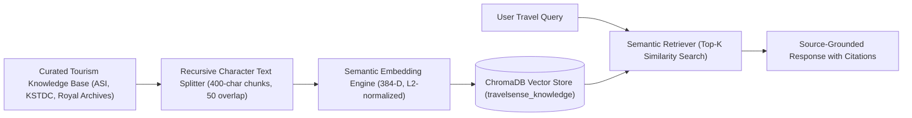
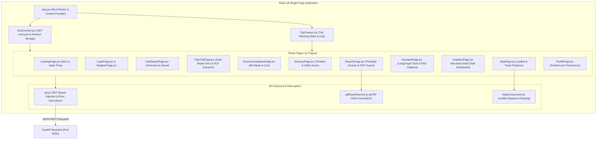
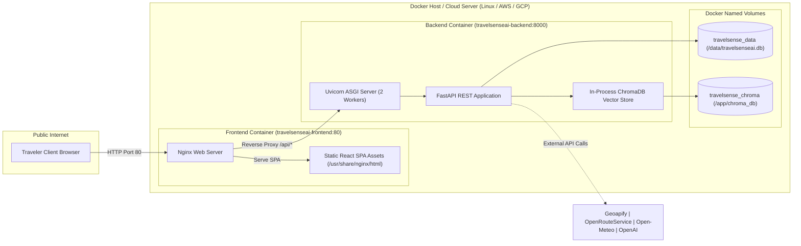

# TravelSenseAI — Architectural Blueprint

## Overview

TravelSenseAI is an intelligent, AI-powered travel planning and tourism recommendation platform. The system is designed using a decoupled, modern multi-tier architecture that separates the presentation tier (React + Vite) from the backend API, database persistence, external geospatial/weather providers, context-aware machine learning recommendation algorithms, and agentic workflows (FastAPI + Python + SQLAlchemy + Geoapify + ORS + Open-Meteo).

---

## High-Level System Architecture

---

## Phase 4: Context-Aware Recommendation Engine

### 1. Mathematical Formulation

The recommendation score $R(p_i)$ for candidate point of interest $p_i$ is computed as the normalized weighted linear combination of six context dimensions:

$$R(p_i) = \sum_{k \in \{P, D, T, W, C, B\}} w_k \times x_{ik}$$

Where all factor scores $x_{ik} \in [0.0, 1.0]$ and weights $w_k$ satisfy $\sum w_k = 1.0$.

#### Configurable Weight Distribution:

| Dimension | Symbol | Default Weight ($w_k$) | Description |
| :--- | :---: | :---: | :--- |
| **Preference Matching** | $P$ | **0.30** | Semantic and categorical alignment with user interests (history, food, photography, etc.) |
| **Distance Suitability** | $D$ | **0.15** | Clamped spatial decay from origin/destination center based on travel mode |
| **Temporal Feasibility** | $T$ | **0.15** | Visit duration compatibility with daily available touring budget & opening hours |
| **Weather Suitability** | $W$ | **0.15** | Real-time weather adaptation (outdoor venues in clear skies vs. indoor venues during rain) |
| **Category Compatibility** | $C$ | **0.15** | Theme affinity and diversity balance across the itinerary |
| **Budget Suitability** | $B$ | **0.10** | Ratio of entrance fees to traveler's daily budget capacity (free venues score 1.0) |

---

### 2. Factor Mathematical Definitions

1. **Preference Matching ($P \in [0.0, 1.0]$)**:
   - Tokenizes and cleans user interest queries and POI metadata (categories, name, description).
   - Maps user interests to semantic synonym vocabularies (e.g. `historical places` $\rightarrow$ `[fort, citadel, heritage, palace, monument, ruins]`).
   - Computes weighted category overlap and token intersection.
   - If no user interests are provided: $P = 0.5$ (neutral baseline).

2. **Distance Suitability ($D \in [0.0, 1.0]$)**:
   $$D = \max\left(0.0, \min\left(1.0, 1.0 - \frac{d}{D_{max}}\right)\right)$$
   - Where $d$ is Great-Circle Haversine distance in km and $D_{max}$ is maximum travel radius (default 35 km).
   - If distance is unrecorded: $D = 0.5$.

3. **Temporal Feasibility ($T \in [0.0, 1.0]$)**:
   - Evaluates estimated visit duration $t_{visit}$ against daily available hours $T_{avail} = H_{daily} \times 60$.
   - Ideal visit duration (45 to 150 minutes) yields $T = 0.95$.
   - Visits exceeding single-day touring budget decay towards $0.10$.
   - Verified permanently closed venues yield $T = 0.0$.
   - If duration is missing: $T = 0.5$ (never fabricated).

4. **Weather Suitability ($W \in [0.0, 1.0]$)**:
   - Categorizes POIs as **Indoor** (museums, galleries, restaurants, covered palaces) or **Outdoor** (parks, viewpoints, open forts, walking tours).
   - **Rainy / Thunderstorm conditions**: Indoor POIs score $0.95$; Outdoor POIs penalized to $0.20 - 0.35$.
   - **Clear / Sunny conditions**: Outdoor POIs score $1.00$; Indoor POIs score $0.80$.
   - **Extreme heat (> 38°C)**: Indoor air-conditioned venues favored ($0.90$) over open outdoor tours ($0.40$).
   - If weather data is unavailable: $W = 0.5$.

5. **Budget Suitability ($B \in [0.0, 1.0]$)**:
   - Free attractions ($c_{place} = 0$) receive $B = 1.0$.
   - Normalized against daily budget allowance $B_{daily} = \frac{Budget_{total}}{Days}$.
   - Modest fees ($\le 10\%$ of $B_{daily}$) score $0.95$.
   - Fees exceeding total budget receive $B = 0.05$ and an attached constraint flag.
   - If entrance fee or budget is missing: $B = 0.5$ (never fabricated).

6. **Category Compatibility ($C \in [0.0, 1.0]$)**:
   - Rewards alignment with target trip themes while preventing category fatigue (e.g. penalizing the 5th museum in a single day).

---

### 3. Baseline Comparison for Empirical Research

To benchmark context-aware multi-criteria recommendation quality against traditional recommender models:
- **Baseline Recommender**: Scores POIs purely by preference matching: $R_{baseline}(p_i) = x_{i, P}$.
- **Rank Displacement Metric**: Measures the number of positions individual POIs shift when contextual factors (weather, distance, time, budget) are introduced:
  $$Displacements = \sum_{i=1}^N \mathbb{I}\left(Rank_{context}(p_i) \neq Rank_{baseline}(p_i)\right)$$

---

### 4. Hard Constraints & Transparency Principles

- **Geographic Boundary Filtering**: Candidates with $d > D_{max}$ are excluded before scoring.
- **Closed Venue Filtering**: Venues verified as permanently closed are excluded.
- **Non-Silent Warning Flags**: Places exceeding daily budget or single-day duration are retained if user interest is high, with explicit `flags` attached (`exceeds_daily_budget_guideline`, `exceeds_single_day_available_hours`).
- **No Data Fabrication**: Missing entrance fees, opening hours, or visit durations are assigned neutral median scores ($0.5$) and left as `null` in place attributes rather than hallucinated.
- **Explainability**: Every recommendation outputs an automated natural language justification highlighting its top-performing dimensions.

---

## Phase 5: Geographic Clustering and Route Optimization

### 1. Spatial Density Clustering (DBSCAN vs. K-Means)

Tourist attractions are partitioned into cohesive geographic neighborhoods to reduce transit overhead.

#### A. Haversine Distance Metric
Clustering operates over spherical great-circle distance on the WGS-84 Earth sphere ($R = 6371.0\text{ km}$):
$$d(\phi_1, \lambda_1, \phi_2, \lambda_2) = 2R \arcsin \sqrt{\sin^2\left(\frac{\Delta \phi}{2}\right) + \cos \phi_1 \cos \phi_2 \sin^2\left(\frac{\Delta \lambda}{2}\right)}$$

#### B. Architectural Comparison: DBSCAN vs. K-Means
| Criteria | DBSCAN (Primary Algorithm) | K-Means (Baseline Comparison) |
| :--- | :--- | :--- |
| **Number of Clusters ($K$)** | Discovered dynamically from local density ($\epsilon$, $min\_samples$). | Requires rigid prior specification of $K$, which is unknown for arbitrary itineraries. |
| **Cluster Geometry** | Identifies arbitrary non-spherical shapes (historic corridors, waterfronts). | Enforces isotropic, spherical, convex clusters. |
| **Outlier & Noise Handling** | Isolates distant attractions (e.g. Ramoji Film City 35 km away) as noise (`cluster_id = -1`). | Forcibly assigns outliers to nearest cluster, heavily skewing centroids. |
| **Coordinate Space** | Directly operates on spherical coordinates in radians via Haversine metric. | Operates on Euclidean planar distance, inducing distortion without projection. |

#### C. Cluster Envelopes
For each valid cluster, the service computes:
- **Centroid**: Arithmetic mean $(\bar{\phi}, \bar{\lambda})$.
- **Radius**: Maximum Haversine distance from centroid to any member: $r = \max_{p \in C} d(\text{centroid}, p)$.
- **Bounding Box**: Spatial envelope defined by $[\min \phi, \max \phi, \min \lambda, \max \lambda]$.

---

### 2. Route Optimization (TSP with Constraints)

Visiting sequences are optimized using a two-stage heuristic combining **Nearest-Neighbor (NN) initialization** with **2-Opt local search**.

#### A. Optimization Pipeline
1. **Distance Matrix Computation**:
   Road distances $D_{road}$ and travel times $T_{travel}$ are calculated using mode-specific circuity factors:
   $$D_{road} = D_{haversine} \times \text{circuity}$$
   $$T_{travel} = \frac{D_{road}}{\text{velocity}_{mode}} \times 60.0\text{ minutes}$$
   - `driving-car`: circuity $1.30$, velocity $55.0\text{ km/h}$
   - `foot-walking`: circuity $1.15$, velocity $4.8\text{ km/h}$
   - `cycling-regular`: circuity $1.20$, velocity $15.0\text{ km/h}$

2. **Nearest-Neighbor Initial Construction**:
   Starting from the designated origin, the tour iteratively selects the nearest unvisited attraction until all POIs are sequenced.

3. **2-Opt Local Search**:
   Iteratively evaluates edge swaps $(u_i, u_{i+1})$ and $(u_j, u_{j+1})$. If reversing the subsegment $u_{i} \dots u_j$ shortens the total path:
   $$\Delta = D(tour_{candidate}) - D(tour_{best}) < 0$$
   The subsegment is reversed. Repeats until reaching a local optimum or iteration cap ($500$). Fixed start and end constraints are preserved.

4. **Quantified Improvement**:
   $$\text{Improvement Percentage} = \max\left(0.0, \frac{D_{initial} - D_{optimized}}{D_{initial}} \times 100\%\right)$$

#### B. Daily Schedule Partitioning
The optimized tour is distributed across multiple calendar days respecting traveler constraints:
- Starts each day at `start_time` (e.g. "09:00").
- Tracks cumulative travel time and attraction visit duration.
- If adding the next attraction exceeds `daily_available_hours` (e.g. 8.0 hours), the current day wraps up (with optional return leg to hotel), and the next day begins at `start_time`.
- Outputs precise timestamps (`arrival_time`, `departure_time`) for each stop.

---

## Phase 6: Itinerary Generation and Budget Management

### 1. Multi-Day Scheduling System & Feasibility Engine

The itinerary generation engine synthesizes recommendations, spatial clustering, route sequencing, weather forecasts, and opening hours into a cohesive multi-day travel schedule.

#### Core Capabilities:
- **Chronological Sequence**: Arrival and departure times calculated for every attraction visit without overlaps.
- **Midday Meal Breaks**: Automatically injects a 60-minute lunch break (~12:30–14:00) when active touring spans through the middle of the day.
- **Opening Hours Compliance**: Parses venue operating windows (`HH:MM - HH:MM`). Identifies unverified hours explicitly rather than assuming constant availability.
- **Daily Time Budget Enforcement**: Prevents days from exceeding traveler limits (`daily_available_hours`).

---

### 2. Weather Adjustment Algorithm

Adapts itinerary suitability based on forecast weather from Open-Meteo:
- **Outdoor Venues**: Heritage forts, botanical gardens, lakes, monuments, open viewpoints.
- **Adverse Weather Trigger**: Precipitation $\ge 2.0\text{ mm}$, storm weather codes ($95-99$), severe rain ($51-67$), or extreme heat ($> 42^\circ\text{C}$).
- **Preference Preservation**: Outdoor attractions selected by the user are **never silently discarded**. Instead, the suitability component is penalized, an explicit warning note is attached, and indoor alternatives (museums, palaces, galleries) are surfaced.

---

### 3. Comprehensive Budget Management & Provenance Separation

Tracks expenditures across five operational categories while preserving price provenance:

$$\text{Total Estimated Cost} = C_{transport} + C_{entrance} + C_{food} + C_{accommodation} + C_{contingency}$$

#### Provenance Separation:
| Tier | Provenance Type | Description |
| :--- | :--- | :--- |
| **Verified** | Official Data | Confirmed venue pricing from database or verified source. |
| **User-Provided** | Traveler Override | Pricing explicitly provided in the request payload. |
| **Estimated** | Calibrated Rates | Road transit ($₹18/\text{km}$ car), meals ($₹1000/\text{person/day}$), hotel ($₹3500/\text{room/night}$). |
| **Unknown** | Conservative Buffer | Unverified fees are **never assumed to be zero**; filled with conservative placeholders ($₹150/\text{person}$) and flagged. |

#### Financial Metrics:
- **Cost per Traveler**: $\frac{\text{Total Cost}}{N_{travelers}}$
- **Remaining Budget**: $\text{Budget} - \text{Total Cost}$
- **Budget Overrun**: $\max(0.0, \text{Total Cost} - \text{Budget})$ with `is_budget_exceeded` flag.
- **Contingency Buffer**: $8\%$ allocated for unforeseen incidentals and tips.

---

### 4. Multi-Criteria Itinerary Optimization Objective Function

The quality of an itinerary $I$ is evaluated using the objective function:

$$U(I) = \alpha R(I) + \beta W(I) + \gamma T(I) + \delta Dv(I) - \lambda Tr(I) - \mu C(I)$$

Where:
- $R(I) \in [0, 1]$: Mean recommendation quality of scheduled attractions.
- $W(I) \in [0, 1]$: Itinerary weather suitability index across all days.
- $T(I) \in [0, 1]$: Time efficiency ratio: $\frac{\sum T_{visit}}{\sum (T_{visit} + T_{travel})}$.
- $Dv(I) \in [0, 1]$: Thematic category diversity score to avoid itinerary fatigue.
- $Tr(I) \in [0, 1]$: Transit penalty measuring road travel friction against available hours.
- $C(I) \in [0, 1]$: Cost penalty reflecting budget utilization and penalizing overruns.

#### Default Configurable Weights:
$$\alpha = 0.30, \quad \beta = 0.20, \quad \gamma = 0.15, \quad \delta = 0.15, \quad \lambda = 0.10, \quad \mu = 0.10$$

#### Optimization Strategy & Limitations:
- **Strategy**: Combines density clustering (DBSCAN) for inter-day geographic segregation, 2-Opt local search for intra-day transit minimization, greedy interval scheduling for meal and opening hour alignment, and penalty-guided pruning against daily time and budget caps.
- **Documented Limitations**:
  - Heuristic 2-Opt does not guarantee global TSP optimality for large stop counts ($N > 50$).
  - Traffic velocities are modeled with empirical mode circuity factors rather than dynamic real-time traffic jam simulations.
  - Venues with completely unverified operating hours require travelers to perform local on-site verification.

---

## Phase 7 — AI Travel Assistant, LangGraph & Retrieval-Augmented Generation (RAG)

Phase 7 introduces an agentic conversational travel assistant that understands natural-language inquiries, orchestrates existing Phase 3–6 backend services, retrieves verified destination knowledge via vector search, and delivers context-grounded travel plans without hallucinating deterministic facts.

### 1. LangGraph Multi-Node Workflow Architecture

#### Workflow State Machine (`AgentState`):
- `user_query`: Raw natural-language input from the traveler.
- `messages`: Multi-turn conversational history.
- `intent`: Classified intent (`plan_trip`, `general_qa`, `weather_query`, `budget_advice`, `explain_recommendation`).
- `destination`: Identified target city/region.
- `preferences`: Structured parameters (`destination`, `duration_days`, `budget`, `interests`, `travel_style`, `transportation`, `travelers_count`).
- `needs_clarification`: Boolean flag indicating missing essential fields (`destination`, `duration_days`, `budget`).
- `clarification_question`: Targeted follow-up question when required fields are missing.
- `rag_sources`: Verified knowledge document chunks retrieved from ChromaDB.
- `weather_info`: Real-time forecast context from Open-Meteo.
- `recommendations`: Ranked POIs scored via the Phase 4 recommendation engine.
- `itinerary`: Multi-day schedule and 2-Opt routes synthesized by Phase 6 itinerary service.
- `validation_report`: Feasibility check results from `itinerary_validator`.
- `final_response`: Natural-language answer clearly separating verified facts from AI suggestions.
- `workflow_trace`: Step-by-step audit trail of nodes executed during the turn.

---

### 2. Retrieval-Augmented Generation (RAG) Subsystem

The RAG architecture grounds conversational responses in curated cultural, historical, and travel knowledge:

#### RAG Components:
1. **Document Loader (`app/rag/document_loader.py`)**:
   - Curated knowledge records covering monuments, palaces, architectural acoustics, culinary heritage (Hyderabadi Biryani, Irani Chai, Haleem), seasonal tips, and city navigation for Hyderabad and Bengaluru.
   - Metadata tags: `title`, `destination`, `category`, `source`, `content`.
2. **Recursive Character Text Splitter (`app/rag/text_splitter.py`)**:
   - Recursively splits long narratives across paragraph breaks (`\n\n`), sentence boundaries (`\n`, `. `), and whitespace, maintaining configurable chunk overlap to preserve context across boundaries.
3. **Semantic Embedding Function (`app/rag/embeddings.py`)**:
   - High-performance, deterministic 384-dimensional vectorizer utilizing subword n-gram MD5 hashing, positional decay weighting, and L2 normalization.
   - Fully compatible with ChromaDB's `EmbeddingFunction` interface (`name()`, `get_config()`, `build_from_config()`, `embed_query()`).
   - Seamlessly delegates to `sentence-transformers` or OpenAI embeddings when models/keys are present.
4. **Vector Store (`app/rag/vector_store.py`)**:
   - Wraps ChromaDB collection `travelsense_knowledge` with automatic initialization, deduplication, and destination metadata filtering.
5. **Retriever (`app/rag/retriever.py`)**:
   - Retrieves top-$k$ relevant chunks and synthesizes grounded answers with explicit citations.

---

### 3. Natural Language Understanding & Clarification Engine

- **Service (`app/services/ai_service.py`)**:
  - Implements two-stage extraction: OpenAI structured JSON extraction when `OPENAI_API_KEY` is active, with seamless zero-dependency deterministic heuristic NLP fallback.
  - Detects destinations (known hubs and regex pattern matching), durations (days, weekends), budgets (rupee symbols, numeric tokens, `k` multipliers), interests (history, food, photography, nature, culture, shopping), travel styles (relaxed, moderate, packed), and traveler group counts.
  - **Clarification Policy**: If any core parameter (`destination`, `duration_days`, `budget`) is omitted, the engine flags `needs_clarification=True` and produces a natural conversational inquiry rather than guessing or fabricating constraints.

---

## Phase 8 — Single-Page Application (SPA) Frontend Architecture

TravelSenseAI features an interactive, decoupled React 18 single-page application built on Vite 5 and styled with Tailwind CSS v3:

---

## Phase 9 — PDF Reporting & Analytics Engine Architecture

The reporting and analytics architecture operates via a hybrid dual-tier design:
1. **Server-Side ReportLab Engine (`app/services/pdf_service.py`)**:
   - Generates publication-grade, multi-page vector PDF travel plans with automated pagination (`NumberedCanvas`), custom color palettes, verified price breakdowns, and weather outlooks.
2. **Analytics Aggregator (`app/services/analytics_service.py`)**:
   - Synthesizes 7 distinct analytical data schemas for interactive visualization:
     - Attraction Category Distribution (Pie / Donut)
     - Recommendation Score Distribution (Histogram)
     - Daily Expense Distribution (Bar chart)
     - Daily Travel vs Visiting Duration (Stacked Area)
     - Route Distance Comparison (Bar chart)
     - Budget Utilization Percentage (Progress / Gauge)
     - Recommended Attraction Count by Day (Column chart)

---

## Phase 10 — Research Benchmarking & Empirical Evaluation Architecture

The empirical evaluation architecture enables scientific validation across multi-criteria metrics without synthetic data fabrication:
- **Controlled POI Corpus (`datasets/poi_corpus.json`)**: 35 realistic attractions in Hyderabad with verified entrance fees, coordinates, and opening schedules.
- **Controlled User Personas (`datasets/user_profiles.json`)**: 10 distinct traveler profiles with multi-expert ground-truth relevance grades (1–3).
- **Automated Experiment Runner (`run_experiments.py`)**: Computes Precision@K, Recall@K, NDCG@K, Haversine road travel distance, travel efficiency ratio $\eta$, constraint violation rate (CVR), Shannon entropy diversity $H(C)$, pairwise Jaccard personalization $S_{\text{pers}}$, and two-tailed paired Student's $t$-tests ($N = 30$).

---

## Phase 11 — Production Deployment Architecture

TravelSenseAI is packaged for production containerization and multi-environment deployment:

### Production Optimizations Applied:
1. **Container Isolation & Separation of Concerns**: Multi-stage Node/Nginx build minimizes frontend image footprint to < 30 MB.
2. **Reverse Proxying**: Nginx routes `/api/` traffic directly to the backend container over internal Docker bridge network (`travelsense_network`), eliminating browser CORS restrictions.
3. **Database Concurrency in SQLite**: SQLite WAL mode (`PRAGMA journal_mode=WAL`) enabled alongside `PRAGMA synchronous=NORMAL` and `PRAGMA foreign_keys=ON` ensures non-blocking concurrent reads during writes.
4. **Volume Persistence**: Named volumes ensure relational data (`travelsenseai.db`) and vector embeddings (`chroma_db`) survive container updates and redeployments.
5. **Multi-Worker ASGI Execution**: Uvicorn runs with dual workers for production request multiplexing.

