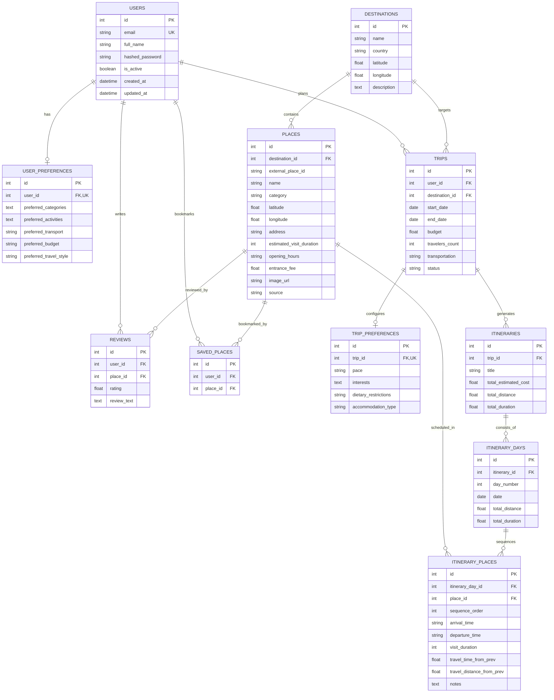

# TravelSenseAI — Database Schema & Relational Data Architecture

**Schema Version:** 1.0.0  
**Primary Engine:** SQLite 3 with Write-Ahead Logging (WAL) Mode  
**Production Alternative:** PostgreSQL 14+ via SQLAlchemy 2.0  
**ORM Framework:** SQLAlchemy 2.0 Declarative Mappings with `Mapped` and `mapped_column`  
**Total Tables:** 11 Relational Entities

---

## 1. Relational Architecture & Engine Configuration

### 1.1 Concurrency & Integrity Optimization (SQLite)
TravelSenseAI configures SQLite connection-level pragmas on every engine connection:
- `PRAGMA foreign_keys = ON;` — Guarantees relational integrity and cascades across child tables.
- `PRAGMA journal_mode = WAL;` — Enables Write-Ahead Logging, allowing concurrent readers without read-write locking conflicts.
- `PRAGMA synchronous = NORMAL;` — Balances ACID durability with high disk I/O performance.

### 1.2 PostgreSQL Migration Pathway
The schema uses dialect-agnostic SQLAlchemy abstractions (`Integer`, `String`, `Float`, `Date`, `DateTime`, `Boolean`, `Text`). Moving from SQLite to PostgreSQL requires:
1. Updating `DATABASE_URL` in `.env` to `postgresql://<user>:<password>@<host>:5432/<dbname>`.
2. Installing `psycopg2-binary` or `asyncpg`.
3. Running initial migrations via Alembic (`alembic upgrade head`).

---

## 2. Entity-Relationship Diagram (ERD)

---

## 3. Data Dictionary: Entity Specifications

### 3.1 `users`
Stores user identities, credentials, and authentication state.
| Column | Type | Constraints | Description |
| :--- | :--- | :--- | :--- |
| `id` | `INTEGER` | `PRIMARY KEY AUTOINCREMENT` | Unique traveler identifier |
| `email` | `VARCHAR(255)` | `UNIQUE, NOT NULL, INDEX` | Account login email address |
| `full_name` | `VARCHAR(100)` | `NOT NULL` | Traveler full display name |
| `hashed_password` | `VARCHAR(255)` | `NOT NULL` | Argon2id cryptographically secure hash |
| `is_active` | `BOOLEAN` | `NOT NULL, DEFAULT True` | Account active state |
| `created_at` | `DATETIME` | `NOT NULL, DEFAULT CURRENT_TIMESTAMP` | Account creation timestamp |
| `updated_at` | `DATETIME` | `NOT NULL, ON UPDATE CURRENT_TIMESTAMP` | Last profile update timestamp |

### 3.2 `user_preferences`
Persistent travel style and default constraints for a traveler.
| Column | Type | Constraints | Description |
| :--- | :--- | :--- | :--- |
| `id` | `INTEGER` | `PRIMARY KEY AUTOINCREMENT` | Preference record ID |
| `user_id` | `INTEGER` | `FOREIGN KEY(users.id) ON DELETE CASCADE, UNIQUE, NOT NULL, INDEX` | Parent user |
| `preferred_categories` | `TEXT` | `NULLABLE` | Comma-separated or JSON category interests |
| `preferred_activities` | `TEXT` | `NULLABLE` | Preferred activity tags |
| `preferred_transport` | `VARCHAR(100)` | `NULLABLE` | Default transit mode (`driving`, `transit`, `walking`) |
| `preferred_budget` | `VARCHAR(50)` | `NULLABLE` | Preferred expenditure tier |
| `preferred_travel_style` | `VARCHAR(100)` | `NULLABLE` | Pace (`relaxed`, `moderate`, `packed`) |

### 3.3 `destinations`
Geographic hubs and metropolitan areas cataloged in TravelSenseAI.
| Column | Type | Constraints | Description |
| :--- | :--- | :--- | :--- |
| `id` | `INTEGER` | `PRIMARY KEY AUTOINCREMENT` | Destination identifier |
| `name` | `VARCHAR(150)` | `NOT NULL, INDEX` | City or region name (e.g. Hyderabad) |
| `country` | `VARCHAR(100)` | `NOT NULL, INDEX` | Country name (e.g. India) |
| `latitude` | `FLOAT` | `NULLABLE` | Central reference latitude |
| `longitude` | `FLOAT` | `NULLABLE` | Central reference longitude |
| `description` | `TEXT` | `NULLABLE` | Curated overview of destination |

### 3.4 `places`
Tourist attractions, heritage monuments, restaurants, and activity points.
| Column | Type | Constraints | Description |
| :--- | :--- | :--- | :--- |
| `id` | `INTEGER` | `PRIMARY KEY AUTOINCREMENT` | Internal place identifier |
| `destination_id` | `INTEGER` | `FOREIGN KEY(destinations.id) ON DELETE CASCADE, NOT NULL, INDEX` | City reference |
| `external_place_id` | `VARCHAR(100)` | `NULLABLE, INDEX` | Geoapify place identifier |
| `name` | `VARCHAR(200)` | `NOT NULL, INDEX` | Venue / attraction name |
| `category` | `VARCHAR(100)` | `NULLABLE, INDEX` | Normalized category |
| `description` | `TEXT` | `NULLABLE` | Curated background description |
| `latitude` | `FLOAT` | `NULLABLE` | WGS84 latitude coordinate |
| `longitude` | `FLOAT` | `NULLABLE` | WGS84 longitude coordinate |
| `address` | `VARCHAR(255)` | `NULLABLE` | Physical street address |
| `estimated_visit_duration` | `INTEGER` | `NULLABLE` | Recommended visit time in minutes |
| `opening_hours` | `VARCHAR(255)` | `NULLABLE` | Verified operating hours string |
| `entrance_fee` | `FLOAT` | `DEFAULT 0.0` | Standard ticket price in local currency |
| `image_url` | `VARCHAR(500)` | `NULLABLE` | Photo asset URL |
| `source` | `VARCHAR(50)` | `DEFAULT 'internal'` | Data origin (`asi`, `tstdc`, `geoapify`) |

### 3.5 `trips`
Trip planning containers capturing dates, budgets, and participant counts.
| Column | Type | Constraints | Description |
| :--- | :--- | :--- | :--- |
| `id` | `INTEGER` | `PRIMARY KEY AUTOINCREMENT` | Trip identifier |
| `user_id` | `INTEGER` | `FOREIGN KEY(users.id) ON DELETE CASCADE, NOT NULL, INDEX` | Traveler creator |
| `destination_id` | `INTEGER` | `FOREIGN KEY(destinations.id) ON DELETE CASCADE, NOT NULL, INDEX` | Target city |
| `start_date` | `DATE` | `NOT NULL` | Trip starting date |
| `end_date` | `DATE` | `NOT NULL` | Trip conclusion date |
| `budget` | `FLOAT` | `DEFAULT 0.0` | Total allocated budget capacity |
| `travelers_count` | `INTEGER` | `DEFAULT 1, NOT NULL` | Group size |
| `transportation` | `VARCHAR(100)` | `NULLABLE` | Chosen mode of transport |
| `status` | `VARCHAR(50)` | `DEFAULT 'planned', NOT NULL, INDEX` | Status (`planned`, `ongoing`, `completed`) |

### 3.6 `trip_preferences`
Trip-specific configurations overriding global user preferences.
| Column | Type | Constraints | Description |
| :--- | :--- | :--- | :--- |
| `id` | `INTEGER` | `PRIMARY KEY AUTOINCREMENT` | Record ID |
| `trip_id` | `INTEGER` | `FOREIGN KEY(trips.id) ON DELETE CASCADE, UNIQUE, NOT NULL, INDEX` | Parent trip |
| `pace` | `VARCHAR(50)` | `NULLABLE` | Daily pace (`relaxed`, `moderate`, `packed`) |
| `interests` | `TEXT` | `NULLABLE` | Thematic keywords for this trip |
| `dietary_restrictions` | `VARCHAR(255)` | `NULLABLE` | Dietary restrictions |
| `accommodation_type` | `VARCHAR(100)` | `NULLABLE` | Hotel / stay preference |

### 3.7 `itineraries`
Master multi-day itinerary schedule containing aggregated metrics.
| Column | Type | Constraints | Description |
| :--- | :--- | :--- | :--- |
| `id` | `INTEGER` | `PRIMARY KEY AUTOINCREMENT` | Itinerary ID |
| `trip_id` | `INTEGER` | `FOREIGN KEY(trips.id) ON DELETE CASCADE, NOT NULL, INDEX` | Parent trip |
| `title` | `VARCHAR(200)` | `NOT NULL` | Schedule title |
| `total_estimated_cost` | `FLOAT` | `DEFAULT 0.0` | Sum of admission fees and dining |
| `total_distance` | `FLOAT` | `DEFAULT 0.0` | Total road travel in km |
| `total_duration` | `FLOAT` | `DEFAULT 0.0` | Total touring duration in hours |

### 3.8 `itinerary_days`
Daily schedule partitioning within an itinerary.
| Column | Type | Constraints | Description |
| :--- | :--- | :--- | :--- |
| `id` | `INTEGER` | `PRIMARY KEY AUTOINCREMENT` | Day ID |
| `itinerary_id` | `INTEGER` | `FOREIGN KEY(itineraries.id) ON DELETE CASCADE, NOT NULL, INDEX` | Parent itinerary |
| `day_number` | `INTEGER` | `NOT NULL` | Day sequence index ($1, 2, \dots$) |
| `date` | `DATE` | `NOT NULL` | Specific calendar date |
| `total_distance` | `FLOAT` | `DEFAULT 0.0` | Day-wise road distance in km |
| `total_duration` | `FLOAT` | `DEFAULT 0.0` | Day-wise touring hours |

### 3.9 `itinerary_places`
Visiting sequence items within a specific day.
| Column | Type | Constraints | Description |
| :--- | :--- | :--- | :--- |
| `id` | `INTEGER` | `PRIMARY KEY AUTOINCREMENT` | Sequence item ID |
| `itinerary_day_id` | `INTEGER` | `FOREIGN KEY(itinerary_days.id) ON DELETE CASCADE, NOT NULL, INDEX` | Parent day |
| `place_id` | `INTEGER` | `FOREIGN KEY(places.id) ON DELETE CASCADE, NOT NULL, INDEX` | Referenced venue |
| `sequence_order` | `INTEGER` | `NOT NULL` | Visiting order index ($1, 2, \dots$) |
| `arrival_time` | `VARCHAR(10)` | `NULLABLE` | Estimated arrival (HH:MM) |
| `departure_time` | `VARCHAR(10)` | `NULLABLE` | Estimated departure (HH:MM) |
| `visit_duration` | `INTEGER` | `NULLABLE` | Allocated visit duration in minutes |
| `travel_time_from_prev` | `FLOAT` | `NULLABLE` | Travel time from previous waypoint |
| `travel_distance_from_prev` | `FLOAT` | `NULLABLE` | Travel distance from previous waypoint |
| `notes` | `TEXT` | `NULLABLE` | Context notes or weather warnings |

### 3.10 `reviews`
User feedback ratings and comments on visited POIs.
| Column | Type | Constraints | Description |
| :--- | :--- | :--- | :--- |
| `id` | `INTEGER` | `PRIMARY KEY AUTOINCREMENT` | Review ID |
| `user_id` | `INTEGER` | `FOREIGN KEY(users.id) ON DELETE CASCADE, NOT NULL, INDEX` | Reviewer |
| `place_id` | `INTEGER` | `FOREIGN KEY(places.id) ON DELETE CASCADE, NOT NULL, INDEX` | Reviewed venue |
| `rating` | `FLOAT` | `NOT NULL` | Score ($1.0$ to $5.0$) |
| `review_text` | `TEXT` | `NULLABLE` | Qualitative review text |
| *Composite Constraint* | `UNIQUE(user_id, place_id)` | Enforces single review per user per venue |

### 3.11 `saved_places`
User bookmark / wishlist of candidate attractions.
| Column | Type | Constraints | Description |
| :--- | :--- | :--- | :--- |
| `id` | `INTEGER` | `PRIMARY KEY AUTOINCREMENT` | Bookmark ID |
| `user_id` | `INTEGER` | `FOREIGN KEY(users.id) ON DELETE CASCADE, NOT NULL, INDEX` | Traveler |
| `place_id` | `INTEGER` | `FOREIGN KEY(places.id) ON DELETE CASCADE, NOT NULL, INDEX` | Bookmarked venue |
| *Composite Constraint* | `UNIQUE(user_id, place_id)` | Prevents duplicate bookmarks |

